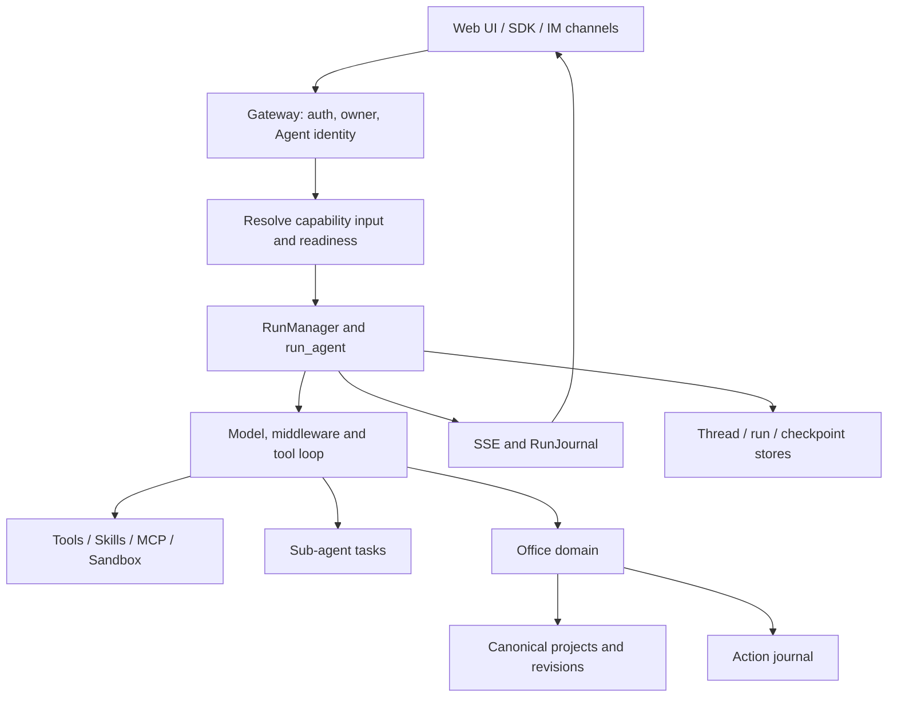

# VassilFlow project review — 12 September 2026

Review date: 2026-09-12.

> Historical snapshot: this report describes the working tree on the review
> date, including Office components and defects that later changed or were
> removed. Its line references, findings, and test counts are historical
> evidence. It is not a description or validation of the later
> `vassilflow-core` 0.1.0 release.

The review covered the working tree, including uncommitted changes. Its purpose
was to understand the architecture, maturity, and development priorities for
turning VassilFlow into an agent application. No application code was changed,
no real LLM tasks were run, and no user data was manipulated. This report was
the new document added during the review.

**Main assessment:** VassilFlow already had an agent harness suitable as a
product foundation: a shared runtime, tools, middleware, subagents, memory,
sandbox, streaming, and specialized agents. The architectural direction suited
adding domain agents. The main areas needing reinforcement were reliability
for long-running tasks, execution budgets, chat UI consistency, and the
single-process deployment limit.

This review covered key flows and modules. It did not certify that every line
had been checked or constitute a comprehensive security assessment. Findings
from source inspection, limited reproductions, and test results are
distinguished below.

## System map

The package manifests declared version 2.1.0. The backend used Python >=3.12,
FastAPI, LangChain/LangGraph, Pydantic, SQLAlchemy, and Alembic. The frontend used
Next.js 16, React 19, TypeScript, TanStack Query, and the LangGraph SDK. These
versions came from the checkout's manifests, not from a search for the latest
versions online.

| Layer | Responsibility | Main entry points |
| --- | --- | --- |
| Frontend | Agent catalog, chat, uploads, streaming, history, artifacts, Office workspace | `frontend/src/app/workspace/`, `frontend/src/components/workspace/` |
| Gateway | Authentication, ownership checks, request normalization, REST/SSE, run creation | `backend/app/gateway/app.py`, `services.py` |
| Harness | Model/tool loop, middleware, skills, memory, subagents, sandbox | `backend/packages/harness/vassilflow/` |
| Runtime | RunManager, worker, stream bridge, checkpoint, journal, lifecycle | `vassilflow/runtime/` |
| Agent/capability | Identity, policy, trusted input, readiness, domain extensions | `vassilflow/config/builtin_agents.py`, `vassilflow/capabilities/` |
| Office domain | Document creation/inspection/editing/rendering, projects, revisions, reviews, templates | `vassilflow/community/office/` |
| Operations | Proxy, containers, sandbox/provisioner, renderer, setup checks | `docker/`, `scripts/`, `Makefile` |

Nginx used port 2026, the frontend 3000, and Gateway 8001. `/api/langgraph/*`
was proxied to the compatibility API in Gateway. The default deployment path
did not require a separate LangGraph server.



## How an agent request moves through the system

1. The frontend selects `assistantId`, creates or opens a thread, handles
   uploads, and sends input with the execution mode. `ThreadChatPage` is shared
   by general chat and agent-specific chat.
2. Gateway obtains the user from the auth context, checks thread access,
   normalizes agent identity, and rejects conflicting copies of that identity
   in the request.
3. A server-side adapter resolves capability input received from the browser
   again. Office selection must match the owner, revision, hash, object path,
   and fingerprint.
4. The runtime checks readiness before creating a run, binds the agent to the
   thread, and calls `RunManager.create_or_reject()`.
5. `run_agent()` sets up the journal, runtime context, checkpoint/store, builds
   the agent, and runs `agent.astream()`.
6. The model calls tools through the middleware chain. Events pass through the
   stream bridge; the journal records history and execution observations.
7. The worker finalizes run/thread status and saves the associated information.
   Office changes have their own evidence in the domain and Action journal.
   A successful run does not by itself prove that every mutation succeeded.

Main sources: `backend/app/gateway/services.py:679`,
`backend/packages/harness/vassilflow/runtime/runs/worker.py:124`, and
`frontend/src/components/workspace/chats/thread-chat-page.tsx:192`.

## Three agent concepts to distinguish when developing a product

| Concept | Implementation | Meaning |
| --- | --- | --- |
| Default agent | `lead_agent` | General-purpose agent using the configured model, tools, and middleware |
| Personal / built-in agent | `AgentConfig` + `SOUL.md`, or `BuiltinAgentDefinition` | Specialized product sharing the runtime, with its own prompt, model, tools, skills, and policy |
| Subagent | `SubagentExecutor`, `task` tool | Work delegated by the lead agent within a run, with separate context and a returned result |

Personal agents were stored per user, with `name`, `description`, `model`,
`tool_groups`, `skills`, and `SOUL.md` content. The built-in registry declared
Office as a specialized agent. Catalog categories did not mean that each
category already had a built-in agent.

A subagent received its own prompt and returned a result to the lead, using
the same granted workspace/sandbox scope and inheriting policy. The `task`
tool was excluded from child tasks to prevent recursive delegation. The
mechanism supported one level of delegation; there was no team mailbox or
follow-up assignment to a worker that had already completed.

Long-term memory extracted facts/preferences into JSON per user/agent, with
debouncing, confidence filtering, and correction/reinforcement handling. It
was distinct from conversation checkpoints and was not a vector retrieval/RAG
store. The memory update queue lived in RAM, so a saved checkpoint did not
guarantee that pending extraction would survive a crash.

The UI mapped modes to flags: flash disabled thinking, pro/ultra enabled
planning, and ultra enabled subagents. Policy still determined whether a tool
could actually run. Office did not permit `task`, so enabling ultra did not
automatically grant Office permission to coordinate subagents.

Sources: `config/agents_config.py:39`, `config/builtin_agents.py:125`, and
`frontend/src/core/threads/hooks.ts:1265`.

## Existing strengths of the foundation

- The `app -> harness` boundary was clear, with tests preventing the harness
  from importing `app.*` and preventing the Office domain from reentering
  generic runtime modules.
- Server-owned policy filtered tool schemas and checked again before execution;
  subagents inherited the policy. This was enforcement in code, not solely
  instructions to the model.
- Middleware addressed practical cases: missing tool results after interruption,
  LLM/tool errors, oversized output, loops, read-before-write, usage,
  summarization, and human input.
- MCP had discovery and a mechanism to include tool schemas in context only
  when needed. Skills had allowlists, slash activation, and separate discovery.
- Sandbox providers shared an abstraction. The local provider mapped workspaces
  per thread; AIO provided a container environment. Enabling host bash in
  LocalSandbox did not create an isolation boundary equivalent to a container.
- Checkpoints, run history, token accounting, workspace changes, and tracing
  integration were present. A public Python factory and embedded client were
  available in addition to the web UI.
- The frontend supported optimistic messages, reconnect, regenerate, branching,
  human input, and artifact viewing. Office used an extension registry and the
  shared chat shell.
- CI defined unit tests, E2E, frontend/backend replay, and blocking I/O checks.
  The existence of a workflow did not mean it had been run during this review.

## Office and architectural changes in progress

New files for `actions`, `capabilities`, repositories, and thread lifecycle
showed that the project was moving Office integration toward shared contracts.
Some observations in the 23 July audit described the state before those
changes; its conclusions should not be copied unchanged to describe the
working tree reviewed here.

`AgentCapabilityAdapter` contributed input resolution, middleware, readiness,
and project repositories. Office had source/result hashes, immutable revisions,
receipts describing changes, render evidence, review, and final selection.
Restore created a new revision. Files in the chat workspace were materialized
copies; the canonical artifact lived in the project repository.

Thread lifecycle connected both sides: deleting a chat detached its link but
retained the project; branching defined how links and working copies were
cloned. The Action journal recorded mutation provenance from tools and APIs,
with leases and reconciliation. This was a useful foundation for agents that
produce durable outputs beyond a conversation.

Adding a domain still required updating the lifecycle/reconciliation
composition root (`app/gateway/domain_lifecycle.py`, `domain_repair.py`). This
was an explicit integration step, not a plugin mechanism that automatically
registered every component from a single manifest.

## Confirmed bugs and gaps, in suggested priority order

1. **High priority: the memory callback could repeatedly create `Timer(0)`.**
   At `agents/memory/queue.py:218`, when `_processing` was true, the callback
   called `_schedule_timer(0)` again. Subsequent callbacks encountered the same
   condition until the worker completed. This was reproduced using methods
   extracted from the source AST and FakeTimer: 101 callbacks created 101
   zero-delay timers, with another callback still pending, even when the queue
   was empty. The reproduction did not create real threads. The effect could
   be thread/CPU churn while waiting for memory updates. Use one worker signaled
   when work is pending, or schedule another pass in a controlled way after the
   current pass completes. Existing unit tests passed because they did not
   cover the repeating-callback case.

2. **High priority before expanding deployment: the startup gate allowed a
   configuration beyond the runtime's capabilities.** `app/gateway/deps.py:50`
   allowed multiple workers with PostgreSQL; the test at
   `test_multi_worker_postgres_gate.py:36` confirmed that behavior. RunManager
   and streaming were nevertheless process-local, and the Redis bridge at
   `runtime/stream_bridge/async_provider.py:52` was unimplemented. The
   documentation correctly required one worker, but the guard and error
   message could imply that changing the database was sufficient. Enforce
   the supported topology or validate run coordination, streaming, and
   repository concurrency together. No multi-worker load simulation was run;
   this was an inconsistency verified from source and the deployment contract.

3. **Medium priority: chat list cursors were lost when mapping/filtering the
   cache.** `frontend/src/core/threads/hooks.ts:1693` stored the next offset
   as a Symbol property on an array; helpers at `:1782` and `:1795` created
   new arrays and lost that metadata. Reproduction with the actual helper
   transpiled in memory showed raw `[sidecar,a,b]` becoming visible `[a,b]`,
   with the correct cursor `3`. After map, it became `2`; after filter, it
   could become `undefined`. This could duplicate loads or stop pagination;
   refetching after deletion sometimes masked the issue. Use a page object
   with `items` and `nextOffset`, and test fetch → cache update → next fetch
   together.

4. **Medium priority: history-loading errors did not reach the UI.** At
   `frontend/src/core/threads/hooks.ts:1557`, the code did not check HTTP
   status before reading JSON. The `catch` at `:1607` only wrote to the
   console, so the caller received no error to display as a toast. When the
   API failed, users could see a conversation missing older history without
   an explanation. Add error state/retry to the history flow, or rethrow after
   cleanup. This conclusion came from source inspection; it was not reproduced
   in a browser against a backend 5xx response.

5. **Medium priority for separate frontend/backend origins: the SDK did not
   send the session cookie.** The frontend README allowed a separate Gateway
   URL. The REST fetcher set `credentials: "include"`, but
   `createCompatibleClient()` at `frontend/src/core/api/api-client.ts:156`
   injected only CSRF and assistant binding; the installed SDK did not add
   credentials either. Default fetch behavior does not send cookies to a
   different origin. Standardize this option and test a split-origin setup.
   The default same-origin proxy was unaffected. Browser integration was not
   verified during this review.

6. **Gap for long-running agents: subagent context/token controls did not
   match the lead's controls.** `subagents/executor.py:428` read and injected
   the content of allowed skills; without a separate allowlist, that set could
   be broad. The subagent middleware chain at
   `agents/middlewares/tool_error_handling_middleware.py:278` had loop/safety
   guards but lacked summarization and TokenBudgetMiddleware as used by the
   lead. Usage could be added to the lead after a task, but it was not a direct
   limit while the subagent ran. Give children budgets, scope skill allowlists
   to tasks, and consider loading skills on demand. This finding concerned
   agents permitted to use `task`; Office did not have that permission.

7. **Test isolation bug: a temporary model contaminated global metadata.**
   `backend/tests/test_persistence_scaffold.py:283` declared `_Tmp(Base)`
   with table `_tmp_test` but did not remove it from `Base.metadata`. Running
   the schema parity test at `test_persistence_bootstrap.py:495` afterward
   failed because the table was not part of the migrations. This was reproduced
   with exactly those two tests in that order; bootstrap passed in isolation.
   Use a separate Base for the test or clean up metadata. This was a test-suite
   defect, not evidence of a production migration bug.

## Constraints to account for in product design

- Subagents were tasks with separate context and no checkpointer for resuming
  (`executor.py:425`); the scheduler used a pool of three workers. This should
  not be described as a distributed worker system or as guaranteeing that every
  subagent can automatically resume after restart.
- Runtime subagent limits could differ from the three-worker pool shared by
  the entire process. The task tool's deadline started at submission, so queue
  wait time also affected tasks when multiple users/threads ran concurrently.
- Runs active when the SQLite Gateway restarted were marked as errors by
  recovery. A checkpoint did not mean the active task would resume automatically.
- The application database and file repositories were separate storage layers.
  PostgreSQL did not turn Action, lifecycle, Office, and workspace storage into
  multiple-writer storage. A consistent backup required stopping writes and
  capturing both the database and runtime root; see `docs/PERSISTENCE.md:30`
  and `:45`.
- There was no shared transaction across runs/checkpoints, thread files,
  Action, and domain projects. Recovery needed journals, idempotency, and
  canonical evidence.
- Readiness had caching and probe timeouts. Ready/degraded status did not
  replace permission checks, revision integrity checks, or checks that each
  operation could actually be performed.
- The assistants compatibility API served the SDK, but graph/schema
  introspection returned minimal structures. This was not the full LangGraph
  Platform.
- Some documentation diverged from the code: frontend AGENTS referred to
  `usePoseStream.ts`/`App.tsx`, README retained the `/chats` route, and backend
  CLAUDE included an outdated middleware count. Source and
  `backend/docs/ARCHITECTURE.md` should take precedence when looking up behavior
  at that snapshot.

The local config read during the review enabled token usage but disabled token
budgeting, used LocalSandboxProvider with `allow_host_bash: true`, and enabled
memory. This was the development configuration at that time, not a mandatory
harness default. The presence of budget middleware in source therefore did not
mean a budget was being enforced on that machine.

## Checks performed

The checks used existing dependencies; none were installed. Each row represents
a test group. Reruns are not added together as independent test counts.

| Group | Result |
| --- | --- |
| Frontend `pnpm typecheck` | Passed |
| Frontend `pnpm test` | 56 files, 485 passed, no skips |
| Backend Gateway/run/stream/auth/boundary/journal | 337 passed, 2 deprecation warnings |
| Backend Action/repository/lifecycle/readiness/materialization/boundary | 68 passed, 3 skipped, 1 warning |
| Backend memory queue and subagent executor | 75 passed |
| Backend Office/project/template/selection/repair/persistence | 164 passed, 1 failed because of the test isolation issue above |
| Bootstrap and regression tests run separately | 24 passed |
| Minimal test isolation reproduction | 1 passed, 1 failed, specifically on `_tmp_test` |

The three skips were symlink/directory-link checks that could not run in this
Windows environment. The complete backend suite, full-stack E2E, real LLMs,
real PostgreSQL, a live renderer, and load tests were not run. These results
therefore verified the tested contracts; they did not measure task completion
quality or operational performance.

Main backend commands, run from `backend` with
`.venv\Scripts\python.exe -m pytest`:

```powershell
.venv\Scripts\python.exe -m pytest tests/test_gateway_services.py tests/test_run_manager.py tests/test_run_worker_rollback.py tests/test_stateless_runs_owner_isolation.py tests/test_auth_middleware.py tests/test_harness_boundary.py tests/test_agent_frontend_contract.py tests/test_run_journal.py tests/test_gateway_run_recovery.py tests/test_gateway_run_drain_shutdown.py tests/test_stream_bridge.py -q --tb=short

.venv\Scripts\python.exe -m pytest tests/test_action_store.py tests/test_actions_router.py tests/test_action_provenance.py tests/test_action_reconciliation.py tests/test_project_repository.py tests/test_thread_lifecycle.py tests/test_capability_readiness.py tests/test_agent_runtime_readiness.py tests/test_gateway_readiness.py tests/test_office_materialization.py tests/test_package_import_boundaries.py -q --disable-warnings

.venv\Scripts\python.exe -m pytest tests/test_memory_queue.py tests/test_subagent_executor.py -q --disable-warnings

.venv\Scripts\python.exe -m pytest tests/test_office_projects_router.py tests/test_office_templates_router.py tests/test_office_revisions.py tests/test_office_selection.py tests/test_office_run_selection.py tests/test_office_selection_approval_middleware.py tests/test_office_selection_context_middleware.py tests/test_office_project_workflow.py tests/test_office_tools.py tests/test_projection_repair.py tests/test_persistence_scaffold.py tests/test_persistence_bootstrap.py tests/test_persistence_bootstrap_regression.py -q --disable-warnings

.venv\Scripts\python.exe -m pytest tests/test_persistence_scaffold.py::TestBaseToDictMixin::test_to_dict_and_exclude tests/test_persistence_bootstrap.py::test_create_all_and_alembic_upgrade_produce_same_schema -q --disable-warnings
```

## Suggested development order based on that working tree

1. Fix the memory timer, cache cursor, history errors, SDK credentials, and
   test isolation; add regressions focused on real failure scenarios.
2. Establish the operating contract for one worker, crash recovery, and
   backup/restore of both the database and filesystem. Reject unsupported
   configuration at startup.
3. Strengthen long-running agents: child token/time budgets, skill-loading
   policy, consistent cancellation/timeouts, and clear display of incomplete
   results.
4. Build an evaluation set of representative tasks with output criteria:
   completion rate, artifact correctness, required user interventions, tokens,
   duration, and recovery. Replay checks communication contracts; evaluation
   on real tasks establishes how well the agent works.
5. Add a second domain agent using the existing capability contract to verify
   reuse. Keep business schemas in the domain and share run/stream/chat;
   generalize only what both domains actually share.
6. Once behavior is stable, split `frontend/src/core/threads/hooks.ts` into
   streaming, history, pagination, and mutations to reduce change costs.

**Suggested source entry points for follow-up work:**
`backend/app/gateway/services.py`,
`backend/packages/harness/vassilflow/agents/lead_agent/agent.py`,
`backend/packages/harness/vassilflow/config/builtin_agents.py`,
`backend/packages/harness/vassilflow/capabilities/adapter.py`,
`backend/packages/harness/vassilflow/runtime/runs/worker.py`,
`frontend/src/components/workspace/chats/thread-chat-page.tsx`, and
`frontend/src/core/threads/hooks.ts`.
